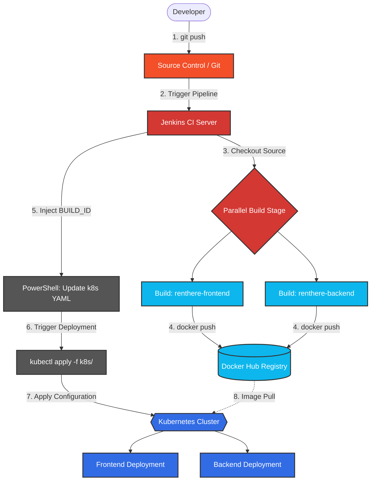

### 1. Explain deployment architecture of your current project

The deployment architecture of the **RentHere** project is built upon a distributed, containerized microservices model that leverages Kubernetes for high availability and automated orchestration. The architecture can be broken down into the following distinct layers:

**A. Application Layer (Microservices)**
The application logic is decoupled into two independent services:
- **Frontend Service:** Contains the user interface and client-side logic.
- **Backend Service:** Contains the API server, business logic, and database connection handling.
Decoupling these services allows them to scale independently based on demand and fail in isolation without bringing down the entire system.

**B. Containerization Layer (Docker)**
Instead of running directly on a host OS, both services are packaged into standardized Docker containers. 
- The `frontend/Dockerfile` and `backend/Dockerfile` define the exact runtime environment (OS, dependencies, environment variables).
- This ensures absolute consistency: the code runs exactly the same on a developer's Windows machine, the Jenkins build server, and the production Kubernetes nodes.

**C. Orchestration Layer (Kubernetes)**
The local Kubernetes cluster serves as the backbone of the deployment architecture, managing the lifecycle of the Docker containers.
- **Deployments:** The `backend-deployment.yaml` and `frontend-deployment.yaml` files define the desired state of the applications. They instruct Kubernetes to wrap the Docker containers in Pods, maintain a specific number of Replicas, and handle self-healing (restarting crashed containers). When a new version is deployed, the Deployment controller performs a Rolling Update, ensuring zero downtime.
- **State Management:** These deployments are stateless, meaning they do not store persistent data locally, allowing Kubernetes to destroy and recreate them safely at any time.

**D. Network Routing Layer (Kubernetes Services)**
Pods are ephemeral and get new IP addresses when restarted. To solve this, the architecture uses Kubernetes Services.
- **Backend Service (`backend-service.yaml`):** Provides a stable, internal DNS name and load balances traffic across all backend Pods. It is only accessible from within the cluster.
- **Frontend Service (`frontend-service.yaml`):** Exposes the frontend Pods to external users (typically via a NodePort or LoadBalancer) while providing load balancing across frontend replicas.

---

### 2. Draw CI/CD workflow

Below is a detailed architectural diagram of the Continuous Integration and Continuous Deployment (CI/CD) workflow. 

---

### 3. Identify DevOps touchpoints in your project

DevOps touchpoints represent the specific intersections where development practices, automation tools, and IT operations integrate. 

| Touchpoint Category | Tool / Technology | Role in Project Architecture |
| :--- | :--- | :--- |
| **Source Code Management (SCM)** | Git / Repository | Acts as the single source of truth. Code commits serve as the catalyst to automatically trigger the CI/CD pipeline. |
| **Continuous Integration (CI)** | Jenkins | Automates the build process. It pulls code, executes parallel builds for frontend/backend, and provides a centralized UI for monitoring build health. |
| **Containerization** | Docker | Standardizes the application environment. It packages the frontend and backend applications into isolated, portable images ready for deployment. |
| **Artifact Repository** | Docker Hub | Serves as the remote container registry (`singhnikhil212`). It securely stores, versions, and distributes the immutable Docker images built by Jenkins. |
| **Infrastructure as Code (IaC)** | YAML Manifests | Defines the desired infrastructure state (Deployments, Services, Replicas) declaratively inside the `k8s/` directory. |
| **Continuous Deployment (CD)** | PowerShell Scripting | Automates the release process. It dynamically edits the IaC manifest files to point to the newest Docker image tags without manual intervention. |
| **Container Orchestration** | Kubernetes & `kubectl` | Manages the live operational state of the application. It handles automated rollouts, load balancing, networking, and self-healing of containers. |
